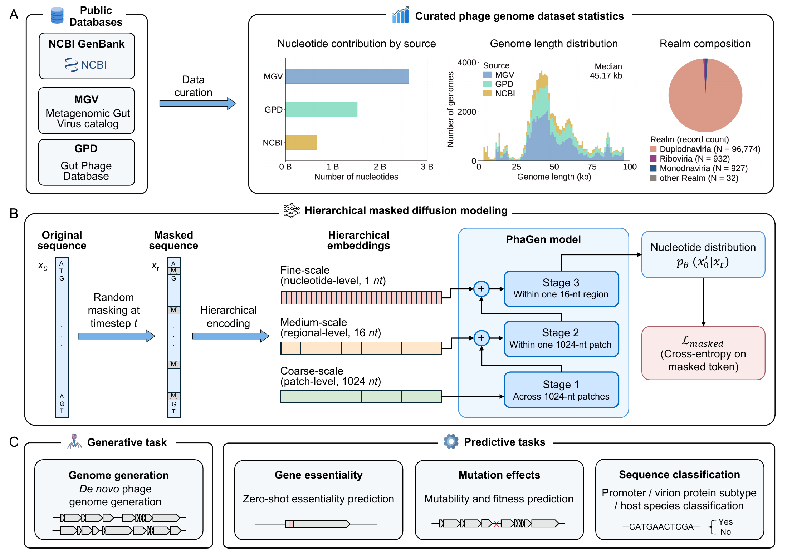

# PhaGen

🌐 [**Project page**](https://ai4nucleome.github.io/PhaGen/) &nbsp;|&nbsp; 🤗 [**Hugging Face**](https://huggingface.co/YusenWithR/PhaGen) &nbsp;|&nbsp; 📦 [**Reproducibility**](https://zenodo.org/records/23477083)

PhaGen is a 150M-parameter model for generating and analyzing bacteriophage DNA.
It learns to reconstruct masked DNA and generates new sequences by filling in
masked positions over multiple steps. The same pretrained model also provides
sequence embeddings and scores for prediction tasks.



*Figure 1 from the paper: training data, model architecture and evaluated tasks.*

Model weights and tokenizer files are available at
[YusenWithR/PhaGen](https://huggingface.co/YusenWithR/PhaGen). The Zenodo archive
also includes this checkpoint under `PhaGen/models/PhaGen/`.

The model has three stages with dimensions of 512, 256 and 196, with eight layers
per stage. It supports up to 131,072 tokens (`max_seq_len` = 128 x 64 x 16),
including sequence boundaries and padding. Its nine-token vocabulary is `[BOS]`,
`A`, `T`, `C`, `G`, `[EOS]`, `[MASK]`, `[PAD]` and `[UNK]`.

## Training and evaluation

| Component | Code | Documentation |
| --- | --- | --- |
| Training with [VeOmni](https://github.com/ByteDance-Seed/VeOmni) | [training/](training/) | [Environment setup, configuration, and training commands](training/README.md) |
| Genome generation and seven prediction benchmarks | [evaluation/](evaluation/) | [Task descriptions and evaluation materials](evaluation/README.md) |

See the training documentation for data requirements and launch instructions.

Evaluation data, formal results, plotting code, and figures are available on
[Zenodo](https://zenodo.org/records/23477083).
Download and extract `PhaGen-complete.zip`; the evaluation materials are under
`PhaGen/evaluation/`.

## Install

Use Python 3.10+. Clone the repository and install PhaGen and its dependencies,
including PyTorch 2.5 and Transformers 4.54.1:

```bash
git clone https://github.com/ai4nucleome/PhaGen.git
cd PhaGen
python -m pip install -e .
```

## Extract sequence embeddings

Load the model and convert DNA sequences into 964-dimensional vectors:

```python
import torch
from phagen import load_model, load_tokenizer

checkpoint = "YusenWithR/PhaGen"
tokenizer = load_tokenizer(checkpoint)
model = load_model(checkpoint, device="cpu")

batch = tokenizer(
    ["ACGTACGTAC", "GATTACA"], padding=True,
    add_special_tokens=False, return_tensors="pt",
).to(model.device)
with torch.inference_mode():
    embeddings = model.embed(batch["input_ids"], batch["attention_mask"])
print(embeddings.shape)
```

The output has shape `(2, 964)` and uses float32. To process a FASTA file:

```bash
python examples/embed.py --input examples/sequences.fasta \
  --output outputs/embeddings.pt
```

The saved file contains sequence `ids` and an `embeddings` tensor in input order.
The FASTA example accepts nonempty A/C/G/T sequences, converts lowercase to
uppercase and rejects ambiguous bases. Sequences are not truncated.

## Generate DNA

Run a short generation example:

```bash
python examples/generate.py --length 256 --steps 32 --seed 42 \
  --output-dir outputs/generate
```

The script calls `model.diffusion_generate` and saves token IDs to `tokens.pt`.
It uses `model.extract_contigs` to write complete A/C/G/T sequences bounded by
`[BOS]` and `[EOS]` to `contigs.fasta`. Short runs may produce no complete sequence.
Keep the token IDs when extracting sequences: removing special tokens from the
whole output can join separate sequences.

The paper uses a 131,072-token canvas, 256 steps, seed 42, entropy sampling with
`alg_temp=0.1`, `temperature=1.1`, `top_p=0.90` and `top_k=4`, and retains complete
contigs of at least 2,000 bases. The token budget includes the initial `[BOS]`.

Both example scripts default to `YusenWithR/PhaGen`, CPU and float32. Use
`--device cuda` for a GPU and `--dtype bfloat16` where supported. Long sequences
and full-length generation require a suitable GPU. For offline use, pass
`--model /path/to/local/checkpoint --local-files-only`; in Python, pass the local
directory and `local_files_only=True` to both loaders. Use `--help` for all options.

From the extracted archive's `PhaGen/` directory, use
`--model models/PhaGen --local-files-only` with either example. In Python:

```python
tokenizer = load_tokenizer("models/PhaGen", local_files_only=True)
model = load_model("models/PhaGen", device="cpu", local_files_only=True)
```

## Layout

```text
PhaGen/
├── assets/figure1.png                      Paper overview figure
├── src/phagen/
│   ├── __init__.py                         Public API exports
│   ├── configuration_phagen.py             PhaGen model configuration
│   ├── modeling_phagen.py                  Hierarchical model and forward pass
│   ├── generation_utils.py                 Masked-diffusion sampling
│   ├── embedding_utils.py                  Sequence representation pooling
│   ├── sequence_utils.py                   BOS/EOS-delimited contig extraction
│   └── loading.py                          Model and tokenizer loading
├── examples/
│   ├── embed.py                            FASTA-to-embedding example
│   ├── generate.py                         DNA generation example
│   └── sequences.fasta                     Small example input
├── training/
│   ├── train.sh                            Distributed training launcher
│   ├── configs/paper_reference.yaml         Paper training configuration
│   ├── tasks/train_torch_dllm.py             Training and validation entry point
│   ├── scripts/split_parquet.py             Train/validation data split
│   ├── veomni/
│   │   ├── models/transformers/phagen/      PhaGen training model
│   │   ├── data/                           Dataset loading, packing and masking
│   │   ├── distributed/                    Distributed training utilities
│   │   ├── optim/                          Optimizers and learning-rate schedules
│   │   ├── checkpoint/                     Checkpoint management
│   │   ├── ops/                            Training operators
│   │   └── utils/                          Framework utilities
│   └── licenses/                           Third-party license texts
└── evaluation/
    ├── generation/task1_unconditional_generation/
    │   └── scripts/
    │       ├── generation/                 Model sampling and reference construction
    │       ├── sequence_analysis/          Sequence/ORF statistics, geNomad and BLAST
    │       ├── protein_analysis/           Protein composition, function and upstream analysis
    │       ├── sweeps/                     Decoding-parameter and step comparisons
    │       └── timing/                     Generation-latency measurements
    └── prediction/
        ├── task1_gene_enssentiality/        Lambda and P1 gene essentiality
        ├── task2_proteins_functions/        T7 SNP mutability
        ├── task4_phage_promoter/            Phage promoter recognition
        ├── task5_pvp/                       Virion-protein subtype prediction
        ├── task6_tail-based_host/           Tail-protein CDS host prediction
        ├── supl_task1_infA_fitness/         infA mutation fitness
        └── supl_task2_beta-lactamase_fitness/  TEM-1 beta-lactamase fitness
```

The public model classes are `PhaGenModel` and `PhaGenConfig`, with
`model_type="phagen"`.

## Acknowledgement

PhaGen builds on the following open-source projects:

- [MEGABYTE](https://github.com/lucidrains/MEGABYTE-pytorch)
- [Open-dLLM](https://github.com/pengzhangzhi/Open-dLLM)
- [VeOmni](https://github.com/ByteDance-Seed/VeOmni)

Code authored for this project is licensed under Apache-2.0. Adapted upstream code
retains its original terms; see [NOTICE.md](NOTICE.md) and [LICENSE](LICENSE).

## Contact

For questions, open a GitHub issue or email
[yhou925@connect.hkust-gz.edu.cn](mailto:yhou925@connect.hkust-gz.edu.cn).
